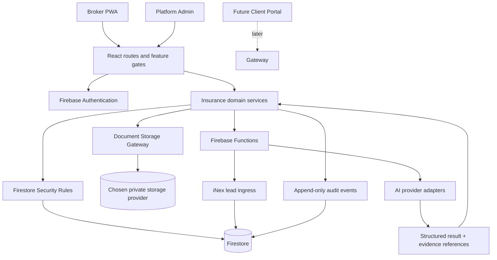

# InsurNex — Master Architecture

> **Status:** architecture baseline, 24 October 2026. This document distinguishes current repository behavior from target capabilities. A documented target is not proof that a feature is implemented or deployed.

## 1. Product boundary

InsurNex is a multi-tenant insurance-brokerage operating platform. The existing React/Vite app and Firebase project remain the foundation; development must extend the existing domain modules rather than replace them with a generic CRM or start a parallel app.

Primary lifecycle:

`iNex lead → Lead qualification → Needs analysis → Quotation/RFQ → Policy issuance → Documents → Claims/Tasks → Renewal → Retention/Cross-sell`

The broker remains the decision-maker. AI provides evidence-backed analysis and draft actions; it must not autonomously issue policies, approve/reject claims, diagnose a patient, or make binding coverage decisions.

## 2. Current stack confirmed in the repository

| Layer | Current implementation | Architectural note |
|---|---|---|
| Web client | React 19, TypeScript, Vite, React Router | Existing routes, feature gates and page components must be preserved. |
| Installable app | Web App Manifest + production Service Worker | Static assets only are cached; no private business data is cached for offline use. |
| Authentication | Firebase Authentication | User profile and active organization are represented in Firestore. |
| Business data | Cloud Firestore | Existing top-level collections use `organizationId` tenant scoping. |
| Authorization | Firestore Security Rules, route guards and feature gates | Route/feature gates are UX controls; Firestore rules and server-side checks remain the security boundary. |
| Server-side AI | Firebase callable Functions, including `medicalClaudeAnalysis`; Copilot export is in `functions/src/copilot` | Provider secrets must remain server-side. Medical analysis enforces Firebase Auth and App Check. |
| Document storage | Both legacy Firebase Storage code and a Supabase Edge Function gateway exist | This is a dual-path implementation. Do not assume one provider is canonical until the call sites and deployment configuration are reconciled. |
| iNex integration | Firebase HTTPS function `ingestINexLead` | Bearer secret, POST-only, minimal contact payload, deterministic lead ID and transaction-based idempotency. |
| Hosting | Firebase Hosting configured to serve Vite `dist` with SPA rewrite | A merge/build does not itself deploy a release. |

## 3. Target logical architecture

The diagram is the target boundary. The current repository still contains some direct client-side Firestore operations and more than one document-storage path. Refactoring toward the target must be incremental and backed by emulator tests.

## 4. Six product layers

| Layer | Existing foundation | Target responsibility |
|---|---|---|
| CRM | Clients, leads, lead activities, client timeline | A single client 360 record, assignments, notes, communication history and lifecycle links. |
| Insurance Management | Policies, renewals, claims, insurers, RFQs/operations | Quote-to-policy lifecycle, expiry rules, claim workflow and insurer relationships. |
| Document Intelligence | Document records and storage adapters | Secure ingestion, OCR/extraction, source-page/field evidence and human verification. |
| Medical Intelligence | Medical analytics engines and callable AI analysis | Deterministic metrics first; AI explains patterns and limitations without diagnosis or treatment advice. |
| Portfolio Assessment | Client risk assessment and insurance-analysis page | Coverage, limits, deductibles, exclusions, gaps and renewal/cross-sell considerations grounded in source policies. |
| AI Copilot | Copilot UI, context payload and server integration | Permission-filtered answers over allowed organization data, with source references and explicit uncertainty. |

## 5. Core data flows

### 5.1 iNex-App lead ingress

1. iNex sends a POST request to the configured InsurNex ingress endpoint over HTTPS.
2. The ingress validates a server-side bearer secret and validates the minimal payload.
3. InsurNex resolves its configured receiving account and active organization server-side; the caller cannot choose an arbitrary organization.
4. A deterministic lead ID and Firestore transaction make retries idempotent.
5. Only the required contact/lead information is transferred; iNex passwords and authentication tokens must never be forwarded into CRM records.

Operational requirements before production acceptance: confirm secret rotation, rate limiting/abuse monitoring, payload contract versioning, delivery logs without PII, and alerting for rejected or unavailable receiver configuration.

### 5.2 Document ingestion and access

1. The user must be authenticated and belong to an active organization.
2. The API/gateway validates organization, target client, object path, file type/size, and permitted role before signing upload/download or delete operations.
3. Store document metadata separately from file bytes. Keep storage paths private; do not rely on a long-lived public download URL as authorization.
4. AI extraction receives only the selected document or approved text needed for the task.
5. Persist extracted fields with document/version reference, page/section evidence, extraction timestamp, model/version and review state.
6. Never cache document contents, medical reports, signed URLs or authenticated API responses in the PWA Service Worker.

**Current implementation gap:** `src/features/documents/document.service.ts` writes to Firebase Storage directly, while `src/features/storage/supabase-storage.provider.ts` uses the Supabase `document-storage` Edge Function gateway. Audit all callers and select a canonical provider before changing storage behavior.

### 5.3 AI analysis

- Calculate financial and medical metrics deterministically in application/server code where possible.
- Send the model a bounded, purpose-specific payload; avoid unnecessary direct identifiers.
- Require structured output validation and attach the source document/data version and evidence for each finding.
- Label findings as evidence, interpretation or proposed follow-up.
- On AI failure, preserve deterministic analytics and show a safe error; do not fabricate a result.
- Do not use AI as a medical diagnostic engine or as an autonomous coverage/claims decision-maker.

## 6. Tenant isolation and authorization

Every tenant-owned record must contain a server-validated `organizationId`. Every query must scope by the active organization, but client-side filtering alone is not security.

- Firebase Auth identifies the user.
- The active Firestore user profile must be present and `status === 'active'`.
- The server/rules derive organization membership from trusted profile/membership data, not from an untrusted client-supplied organization ID alone.
- Owner/Admin/Broker/Sales/Claims/Finance/Staff permissions should be represented as a documented capability matrix and enforced in Firestore Rules or trusted server handlers.
- Platform Admin is separate from organization Admin. Admin membership must be provisioned through a trusted path; clients must not self-assign platform-admin privileges.
- Feature visibility settings are not a substitute for authorization.
- Unknown top-level collections remain deny-by-default for non-platform-admin users.
- Cross-organization reads, queries, creates, updates, deletes and document-storage operations require regression tests.

**Current gap:** the generic tenant-collection rule currently grants same-organization access to active users broadly; role-specific write restrictions are not yet consistently applied to every collection. Treat granular RBAC as a required security phase, not as complete.

## 7. Suggested module boundaries

Keep feature code modular under `src/features/<domain>` and progressively separate:

- `domain`: business types, validation and state transitions.
- `services`: Firestore/API orchestration and explicit organization context.
- `server`: trusted operations, secrets, external providers and signed file access.
- `ai`: provider adapters, prompt/version registry, output schemas, evidence and safety checks.
- `audit`: append-only security/business events.
- `ui`: RTL pages and reusable components.

Avoid introducing a separate microservice per feature at this stage. A modular monolith with trusted server-side boundaries is easier to test and operate for the current product.

## 8. Release gates

A phase is not complete until all applicable checks pass:

1. `npm ci`, `npm run test:pwa`, `npm run lint`, `npm run build`.
2. Firebase Functions build.
3. Firestore Emulator regression tests for positive and negative authorization cases.
4. Unit/integration tests for business state transitions and organization scoping.
5. Mobile acceptance test: login, protected-route refresh, install prompt, standalone launch and offline notice.
6. Production deployment and live smoke test performed separately with an explicit deployment decision.

## 9. Decisions to close before medical-AI production rollout

- Approved AI provider, processing region and contractual data-handling/retention terms.
- Whether raw medical documents may be sent to the selected provider, and under what lawful basis and user/organization consent.
- Medical data retention/deletion policy and who can export or review the data.
- Canonical document-storage provider and signed-URL lifetime.
- Organization-level retention, audit-log retention and customer data export/deletion workflow.

These are decision gates; this document does not assume answers on behalf of the product owner.
