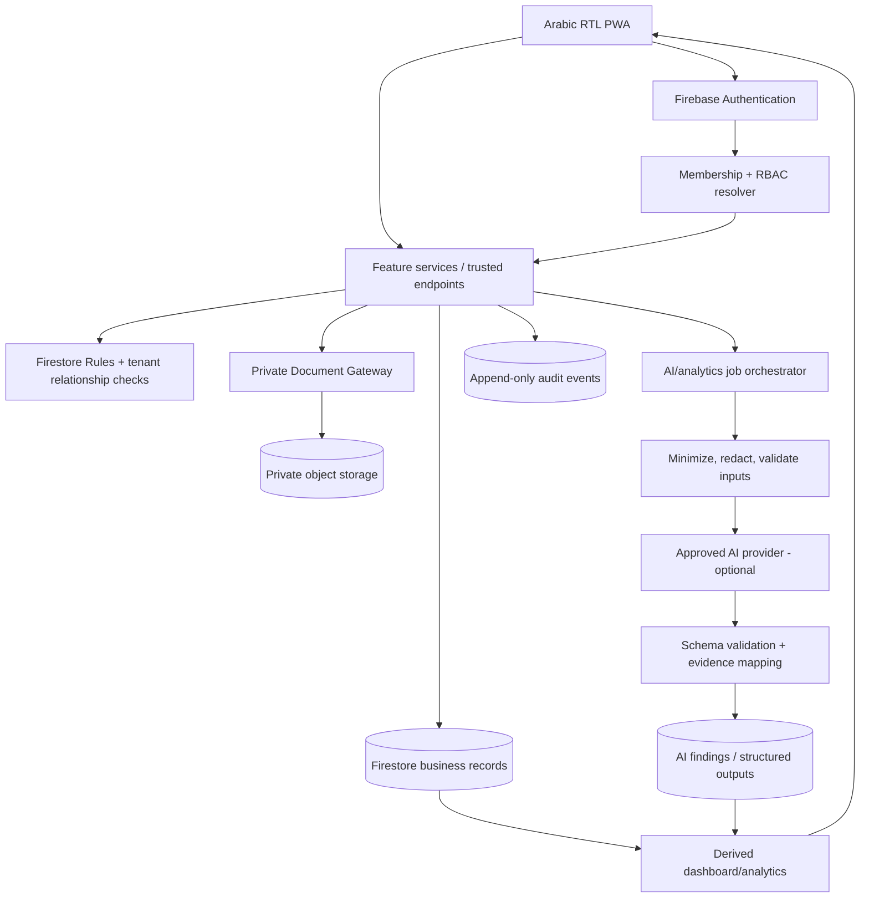

# InsurNex Master Architecture

**Status:** current repository baseline + target architecture. Verified remote baseline: `main` at `5c9c924fdf2033215f94c5c1b64d71ede7ff70ee` (2026-10-30).  
**Change policy:** implementation only through reviewed feature PRs. This document is not a deployment, schema migration or approval to change live data.

## 1. Architecture decisions

1. **Application surface:** React + TypeScript + Vite PWA, mobile-first, Arabic RTL as the default. Keep the existing app shell and module layout; do not rebuild features already present.
2. **Identity:** Firebase Authentication is the identity source. Organization membership and application role are resolved from trusted Firestore membership/profile records. Platform Admin remains a separate, out-of-band provisioned identity; ordinary organization roles cannot self-elevate.
3. **Tenant boundary:** every tenant-owned record must carry an immutable `organizationId`. Access needs active identity + active membership + capability + same-tenant relationship checks. UI visibility is usability only; Firestore Rules and trusted endpoints enforce authorization.
4. **Business data:** Firestore stores structured business records and metadata. Binary documents stay in private object storage and are accessed only through the authorized document gateway using short-lived signed URLs. Do not store signed URLs or bearer tokens in Firestore.
5. **Sensitive data:** the current `clients/{clientId}` model must not remain a container for basic contact, identity/KYC, family, medical, financial, risk narrative, and AI-derived fields all at once. Phase 3 separates these into independently authorized records/projections, with a reversible migration plan and no bulk rewrite until approved.
6. **AI:** AI features are server-side, opt-in/feature-gated, data-minimized and evidence-linked. Authorization happens before prompt assembly. AI output is advisory and must not diagnose, settle claims, determine coverage, bind a policy, or make final suitability/underwriting decisions.
7. **Low-cost posture:** use Firebase/Supabase free or low-cost tiers only where the selected project/account has verified availability and quotas. Do not claim AI is free until a current provider/runtime and quota are confirmed. A safe no-AI fallback is required.
8. **Release posture:** use feature branches, CI, reviewed PRs, staging acceptance, and explicit release approval. No production deploy or live-data migration is included in this architecture change.

## 1A. Current repository state — verified on 2026-10-30

The following distinctions are mandatory when reading this document:

- **Merged source** means code exists in `main`; it does not prove the corresponding Edge Function, Rules, indexes or Hosting build was deployed.
- **Operator-verified local check** means a read-only report or CLI was run locally; it does not change production records.
- **Target design** means a proposed schema, module or rule, not an active runtime capability.

| Capability | Current repository state | Target/remaining gate |
|---|---|---|
| React/Vite Arabic RTL PWA | Existing app and regression checks are present | Preserve routes, functionality, design tokens and responsive identity during all phases. |
| Firebase Auth + Firestore | Existing identity and business-data foundation | Complete action/role/relationship/assignment authorization. |
| Sensitive client data | Legacy mixed fields remain in `clients`; inventory, plan, reviewer and RBAC proposal are merged | Build compatibility data layer; implement per-collection Rules; migrate only after approval and verification. |
| Proposed sensitive collections | Emulator suite asserts default-deny | Do not grant access until a collection-specific security PR has positive and negative tests. |
| Documents | Supabase provider/gateway source and legacy compatibility code exist | Verify deployed Edge Function, private bucket and end-to-end staging behavior; do not assume merged code is live. |
| Copilot | Supabase Edge Function source plus legacy Firebase Functions source | Reconcile provider, cost, context authorization, data sensitivity and deployed endpoint. |
| Firebase Functions | Legacy source remains in repository and is included in build CI | Spark projects cannot deploy new or existing Cloud Functions; select an approved deployable runtime before depending on these endpoints. |
| iNex integration | `ingestINexLead` is exported; deploy script refers to a different name and source receiver currently reads `securepath@nex.com` | Confirm receiving UID/organization and align endpoint/caller/deploy names before enabling traffic. |
| Client document list | Query is scoped by organization and client relationship in the merged service | Keep Firestore Rules relationship authorization; query filters alone are not authorization. |

For current plan/runtime constraints, see [Phase 0 Technical Baseline](PHASE_0_TECHNICAL_BASELINE_2026-10-30.md). For the sequenced work and acceptance criteria, see [Master Execution Backlog](MASTER_EXECUTION_BACKLOG.md).

## 2. Logical module map

| Layer | Modules | Primary records | Key outcomes |
|---|---|---|---|
| Experience | PWA app shell, Arabic RTL, responsive navigation, notifications | user preferences, notification metadata | mobile/desktop access, installable web experience |
| Identity & tenancy | Auth, onboarding, organizations, invitations, memberships, RBAC | users, organizations, memberships, invitations | isolated organization workspaces |
| CRM | Clients, client timeline, leads, needs analysis, sales pipeline | clients, clientSensitiveProfiles, leads, activities, tasks | relationship lifecycle and accountable next steps |
| Insurance operations | Quotes/RFQs, policies, renewals, claims, insurers | quotes, policies, claims, renewals, insurers | end-to-end broker lifecycle |
| Documents | document registry, private storage gateway, category/relationship checks | documents, operationAttachments, audit events | controlled upload/preview/download/delete |
| Medical intelligence | medical consumption imports, normalized claim facts, trend metrics | medicalImportJobs, medicalClaims, medicalReports | aggregate utilization and cost analysis |
| Portfolio intelligence | coverage facts, exclusions, limits, exposures, renewal evidence | coverageAssessments, findings, recommendations | explainable gap analysis and cross-sell prompts |
| Finance & analytics | premium/commission/expense/revenue analytics | commissions, revenue, expenses, analytics snapshots | business and portfolio performance |
| AI intelligence | document extraction, medical analysis, claims/sales assistant, Copilot | aiJobs, aiFindings, copilot conversations | evidence-cited broker assistance |
| Platform operations | platform admin, plans/entitlements, health and audit monitoring | platform settings, plan catalog, audit events | platform operation, without default access to tenant content |

## 3. Data flow



The diagram is conceptual. In implementation, any service using a privileged SDK must independently verify the Firebase ID token, active organization membership, role, resource ownership/relationship and requested action. Never trust a client-supplied role or organization ID on its own.

## 4. Cross-module contracts

- **Canonical tenant key:** `organizationId` (immutable after creation).
- **Canonical identity keys:** Firebase Auth `uid`; `organizationId`; relationship fields such as `clientId`, `policyId`, `claimId`, `leadId`, and `documentId`.
- **Timestamps:** Firestore `Timestamp`, written by trusted services/server timestamp when possible. Keep user-entered effective dates distinct from created/updated audit timestamps.
- **Money:** store amount as integer minor units or numeric EGP amount with explicit `currency`; use one convention consistently per collection before implementation. Never sum unlike currencies without FX evidence.
- **Status:** use closed enums and explicit state transitions. Record actor/time/reason for important transitions; do not allow arbitrary browser-side lifecycle changes.
- **File references:** metadata-only records contain provider, private bucket, canonical object path, storage key version, size, MIME type, checksum if available, uploader, category and relation. Signed URLs are ephemeral response values only.
- **AI findings:** include source resource IDs, source document/version or row IDs, observed values, calculation method, confidence/limitations, model/provider metadata, createdAt, and a human-review state. If evidence is missing, state that instead of guessing.
- **Deletion/export:** define audited export and verified deletion workflows, with retention/legal-hold rules and backup implications before implementing.

## 5. Trust boundaries and permissions

| Principal | Access model |
|---|---|
| Owner | Full business and organization control; cannot bypass tenant boundary |
| Organization Admin | Manage members/settings and business operations within assigned capability; cannot transfer ownership unless a distinct governed workflow permits it |
| Broker | Client/policy/claim work within organization; sensitive records only where explicitly authorized |
| Sales | Leads and minimum-necessary contact information; no default access to medical details, identity credentials, claims narratives or finance records |
| Claims | Assigned/authorized claims, related policy metadata and claim-category documents; no unrelated KYC/medical profile by default |
| Finance | Commission/revenue/expense data and minimum relationship metadata; no medical or identity documents by default |
| Staff | Explicitly granted operational tasks and minimum-necessary record access |
| Platform Admin | Platform configuration, subscription/admin operations and non-sensitive aggregate service telemetry; no routine access to tenant content |
| Trusted service | Only the narrowly scoped operation it executes; validate tenant and relationship again; log outcome without secrets or document contents |

Rules cannot field-mask a readable Firestore document. Sensitive fields must be split into separate documents or returned by trusted projections, each with its own access policy.

## 6. Integration boundaries

### iNex-App lead ingestion
Do not give iNex-App a human user's password or reuse a broker login. Use a dedicated integration principal per organization with a revocable credential/secret held server-side, least-privilege scope (`leads:create` and optionally `leadEvents:create` only), request signature or token verification, timestamp/nonce, rate limiting, idempotency key, payload schema validation and replay protection. The incoming lead should be validated and created by a trusted endpoint; the client cannot choose an arbitrary organization or write directly to tenant collections. Keep credentials out of browser code and logs.

Recommended envelope:
```json
{
  "schemaVersion": 1,
  "source": "iNex-App",
  "externalLeadId": "source-generated-id",
  "submittedAt": "ISO-8601",
  "idempotencyKey": "unique-per-submission",
  "lead": {
    "name": "string",
    "phone": "string",
    "email": "string-or-null",
    "productInterest": "string-or-null",
    "consent": {"status": "granted|unknown", "capturedAt": "ISO-8601-or-null"}
  }
}
```
This is an example contract, not a live endpoint or approved consent text. Store integration mappings separately, deduplicate on `organizationId + source + externalLeadId`, and return only a non-sensitive receipt.

### Document processing
Upload -> validate file size/type -> create pending metadata -> trusted gateway validates membership, relationship and metadata -> signed upload -> verify completion/metadata -> mark active. Download uses a fresh short-lived signed URL after equivalent authorization. Deletion should be stateful/audited and must not silently remove an object still referenced by a policy/claim or required for retention.

### Medical import and analytics
Original file remains private. Parse to a validated staging job, validate columns/data types/currency/time zones, de-identify or pseudonymize before AI if possible, calculate deterministic statistics in code, and use AI only to explain observed changes and generate hypotheses clearly labelled as hypotheses. Do not infer diagnosis or medical necessity.

### AI request/response
Authorized selected records -> field allow-list -> minimize/redact -> provider -> strict JSON schema validation -> evidence/resource IDs checked against supplied records -> findings stored with provenance -> broker review. Never let the model invoke unrestricted tools or select arbitrary tenant records.

## 7. Deployment topology

- **Web/PWA:** Firebase Hosting from Vite build.
- **Identity/business records:** Firebase Authentication and Cloud Firestore with rules/indexes.
- **Trusted jobs/functions:** Firebase Functions and/or the existing Supabase Edge Functions, selected per feature; avoid duplicating overlapping gateways.
- **Private files:** existing private Supabase storage gateway model, pending staging acceptance and approved deployment. Legacy Firebase Storage remains a separate inventory/migration concern.
- **AI:** off by default until provider, legal basis/data processing, quotas, retention, regional handling and server-side access checks are approved.
- **Environments:** local emulators -> staging/project-specific config -> production. Explicitly prohibit accidental deploy from a development branch.

## 8. Operational requirements

- Audit privileged actions, role changes, invitations, sensitive record reads/exports, document signing/deletion and AI jobs.
- Use append-only trusted audit writes; never put tokens, raw documents, national IDs, health values or complete prompts in audit logs.
- Establish rate limits, maximum payload/file sizes, timeouts, retries, idempotency and failure states.
- Track schema version and migration status; migration scripts must be idempotent, resumable, verifiable and reversible.
- Add emulator tests for tenant boundary, role boundary, relationship integrity, field-splitting, ID swapping, invitation replay and expired/deactivated identities.
- Maintain accessibility and responsive behavior in Arabic RTL, including keyboard use, status announcements, reduced motion and readable contrast.

## 9. Definition of done

1. All acceptance checks listed in the phase roadmap pass on the reviewed PR head.
2. No cross-organization read/write or relationship-ID forgery succeeds in emulator tests.
3. Sensitive client data is separated and the app no longer exposes it through broad Client 360 reads.
4. Storage gateway and UI are deployed together only after staging integration acceptance; legacy assets remain recoverable.
5. Every AI finding names the evidence it used and the limits of that evidence; no AI decision is executed automatically.
6. CI, dependency checks, lint, build, functions build and rules tests pass.
7. Rollback and operational ownership are documented before production rollout.
